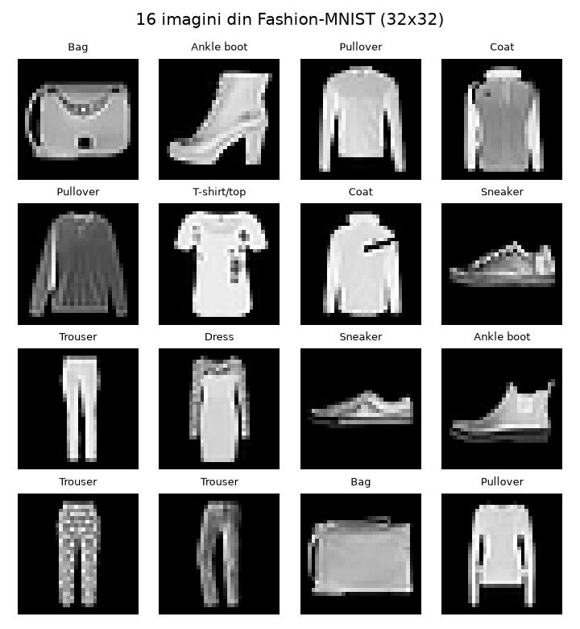
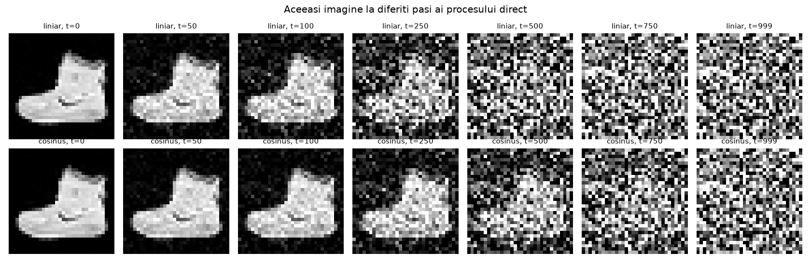
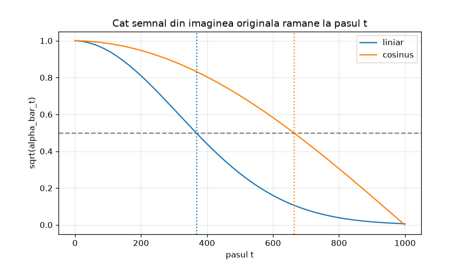
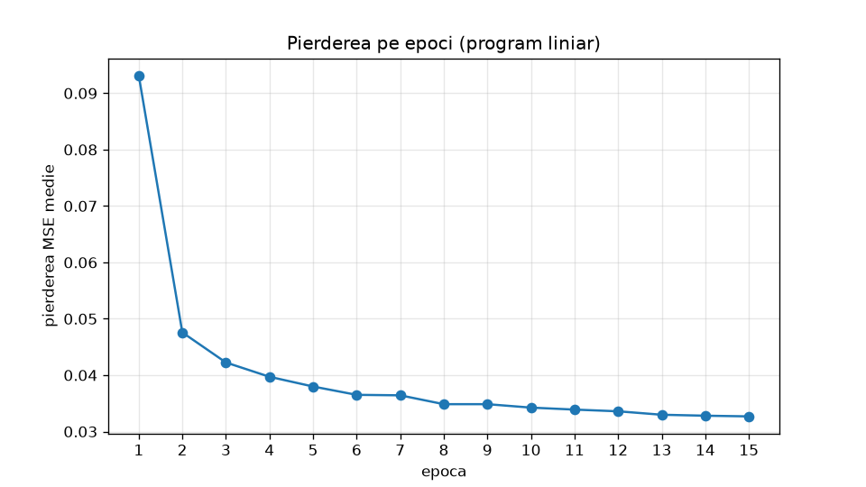
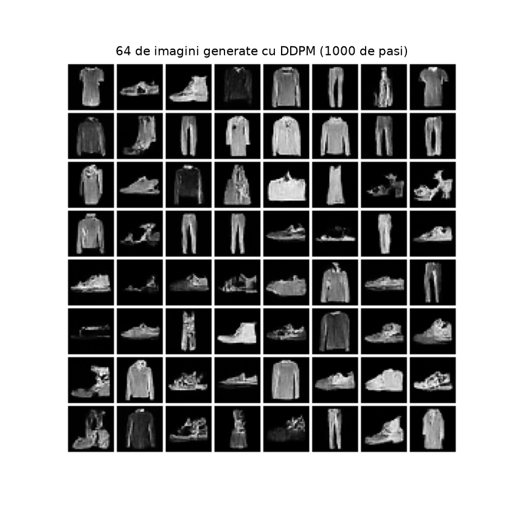
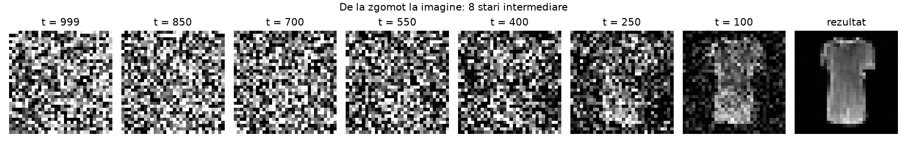
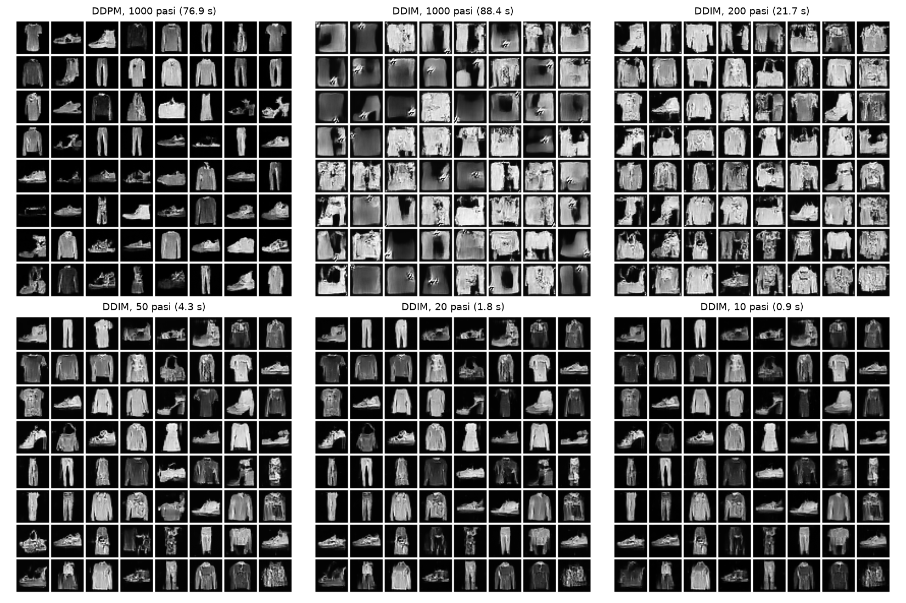
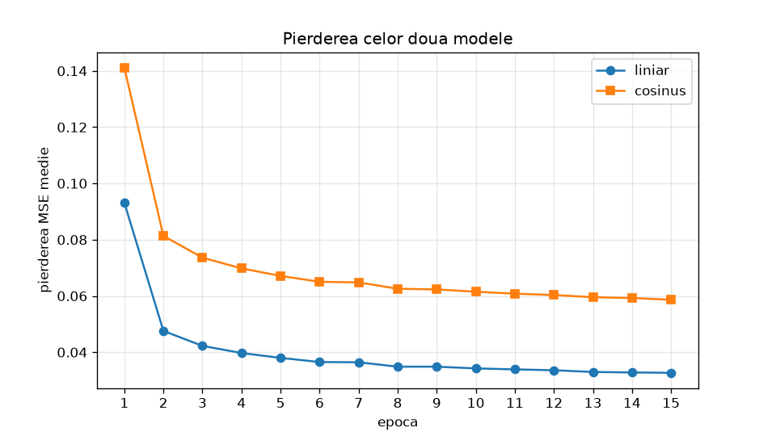
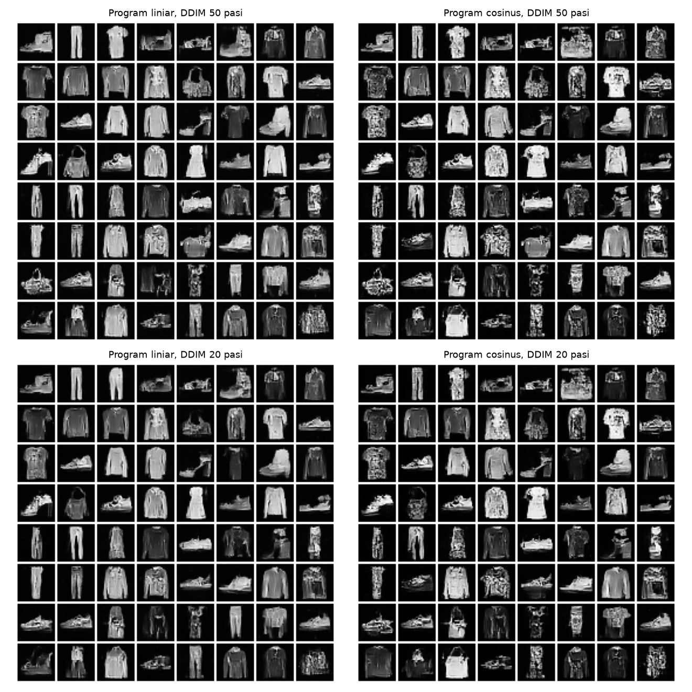
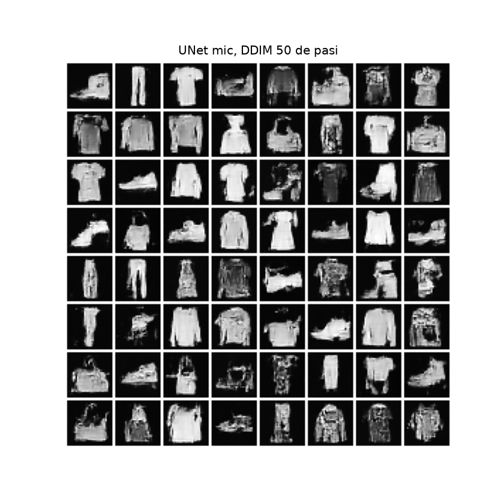

# Laboratorul 4 — DDPM de la zero (Fashion-MNIST)

**Autor:** Iatco Marcel
**Disciplina:** Modele generative — Laboratoarele 4–5: Modele de difuzie
**Tehnologii:** Python 3.12 · PyTorch 2.15 (CPU) · torchvision · matplotlib · pandas · Jupyter Notebook

Implementarea de la zero a unui model de difuzie **DDPM** (*Denoising Diffusion Probabilistic Model*) care generează imagini Fashion-MNIST. Lucrarea compară eșantionarea **DDPM** (1000 de pași) cu eșantionarea **DDIM** (10–1000 de pași) și două programe de zgomot: **liniar** și **cosinus**.

---

## Cuprins

1. [Structura proiectului](#structura-proiectului)
2. [Mediul de lucru și rularea](#mediul-de-lucru-și-rularea)
3. [Sarcina 1 — Datele](#sarcina-1--datele)
4. [Sarcina 2 — Procesul direct](#sarcina-2--procesul-direct)
5. [Sarcina 3 — Rețeaua U-Net](#sarcina-3--rețeaua-u-net)
6. [Sarcina 4 — Antrenarea (program liniar)](#sarcina-4--antrenarea-program-liniar)
7. [Sarcina 5 — Generarea DDPM](#sarcina-5--generarea-ddpm)
8. [Sarcina 6 — DDIM cu mai puțini pași](#sarcina-6--ddim-cu-mai-puțini-pași)
9. [Sarcina 7 — Liniar vs. cosinus](#sarcina-7--liniar-vs-cosinus)
10. [Bonus — Rețea mai mică](#bonus--rețea-mai-mică)
11. [Limitări și observații tehnice](#limitări-și-observații-tehnice)
12. [Concluzii](#concluzii)

---

## Structura proiectului

```
├── Lab4_DDPM_IatcoMarcel.ipynb     # notebook-ul complet, cu rezultate
├── rezultate_lab4/
│   ├── s1_date.png                 # 16 imagini din setul de date
│   ├── s2_proces_direct.png        # procesul direct, ambele programe
│   ├── s2_sqrt_alpha_bar.png       # √ᾱt pentru liniar și cosinus
│   ├── s4_pierdere.png             # pierderea pe epoci (liniar)
│   ├── s5_ddpm.png                 # 64 de imagini DDPM
│   ├── s5_stari.png                # 8 stări intermediare
│   ├── s6_ddim.png                 # DDPM vs. DDIM 1000/200/50/20/10
│   ├── s7_comparatie.png           # liniar vs. cosinus, DDIM 50 și 20
│   ├── s7_pierderi.png             # curbele de pierdere ale celor două modele
│   ├── bonus_unet_mic.png          # rețeaua mică, DDIM 50
│   ├── tabel_sarcina6.csv
│   └── model_*.pt                  # modelele antrenate
└── README.md
```

Setul de date (`date/`) se descarcă automat la prima rulare și nu este inclus în repository.

---

## Mediul de lucru și rularea

| Componentă | Valoare |
|---|---|
| Sistem | Windows 11, Intel Core Ultra i7, 32 GB RAM, fără GPU NVIDIA |
| Dispozitiv de calcul | CPU (16 fire de execuție) |
| Python / PyTorch | 3.12 / 2.15.0+cpu |
| Seed | 42 (inițializare, ordinea loturilor, zgomotul de pornire) |

```bash
conda create -n lab4 python=3.12 -y
conda activate lab4
pip install torch torchvision numpy pandas matplotlib jupyter ipykernel
jupyter notebook Lab4_DDPM_IatcoMarcel.ipynb
```

> **Notă (Windows):** toate bibliotecile se instalează cu `pip` într-un mediu curat. Dacă NumPy/MKL vine din conda și PyTorch din pip, în același proces se încarcă două copii ale `libiomp5md.dll`. Rezultatul este `OMP: Error #15`, iar kernelul se oprește la primul grafic.

Modelele antrenate se salvează în `rezultate_lab4/model_*.pt`. La o nouă rulare ele se reîncarcă de pe disc, fără reantrenare.

---

## Sarcina 1 — Datele

- **Fashion-MNIST**: 60 000 de imagini de antrenare, 10 clase, alb-negru.
- `transforms.Pad(2)`: 28×28 → **32×32**, ca dimensiunea să se poată înjumătăți de 3 ori în U-Net (32 → 16 → 8 → 4).
- Pixelii sunt scalați în **[−1, 1]**, la aceeași scară cu zgomotul gaussian.
- `DataLoader` cu loturi de 128 → **469 de loturi pe epocă**.

Transformarea se aplică vectorizat pe tot setul, iar rezultatul este verificat ca fiind identic cu `transforms.Compose`.



---

## Sarcina 2 — Procesul direct

$$x_t = \sqrt{\bar\alpha_t}\,x_0 + \sqrt{1-\bar\alpha_t}\,\varepsilon,\qquad \varepsilon\sim\mathcal N(0,I),\qquad \bar\alpha_t=\prod_{s\le t}(1-\beta_s)$$

| Program | β | ᾱ₉₉₉ | Primul pas cu √ᾱt < 0,5 |
|---|---|---|---|
| Liniar | 0,0001 → 0,02 (`torch.linspace`) | 4,04·10⁻⁵ | **t = 368** |
| Cosinus (s = 0,008) | 0,000041 → 0,999 | 2,43·10⁻⁹ | **t = 664** |




**Observație:** programul liniar distruge semnalul mult mai repede. Aproximativ un sfert dintre pași (≈ 25%) au √ᾱt < 0,06, adică sunt practic zgomot pur. La programul cosinus, acești pași sunt ≈ 4%. Programul cosinus distribuie mai uniform nivelurile de zgomot.

---

## Sarcina 3 — Rețeaua U-Net

U-Net cu 3 niveluri (32, 64, 128 de canale), blocuri reziduale, conexiuni skip prin concatenare și încorporarea sinusoidală a pasului t.

| Verificare | Rezultat |
|---|---|
| Intrare → ieșire | (8, 1, 32, 32) → (8, 1, 32, 32) ✔ |
| Număr de parametri | **979 585** (≈ 1 milion) |

---

## Sarcina 4 — Antrenarea (program liniar)

Setări: Adam, lr = 0,0002, batch = 128, **15 epoci**, pierdere MSE între zgomotul real și cel prezis.

| Epoca | 1 | 2 | 5 | 10 | 15 |
|---|---|---|---|---|---|
| Pierdere MSE | 0,0931 | 0,0476 | 0,0380 | 0,0342 | **0,0327** |

- **Timp de antrenare:** 74,3 min pe CPU (≈ 5 min/epocă).
- Pierderea scade repede în primele 2–3 epoci, apoi se stabilizează. Nu ajunge la zero, pentru că la pașii cu zgomot foarte mic zgomotul nu poate fi separat exact de imagine.



---

## Sarcina 5 — Generarea DDPM

Algoritmul 2 din Ho et al. (2020), cu σt² = βt, pentru t = 999 → 0, fără zgomot la ultimul pas.

- **64 de imagini în 76,9 s** pe CPU.
- Imaginile sunt clare, pe fundal negru curat, din clase ușor de recunoscut: tricouri, pulovere, pantaloni, rochii, sneakers, sandale, ghete, genți.



**Stările intermediare:** până la t ≈ 400 imaginea pare zgomot pur. Silueta obiectului apare între t = 250 și t = 100, iar detaliile se formează în ultimii ~100 de pași.



---

## Sarcina 6 — DDIM cu mai puțini pași

DDIM determinist, pe șirul `torch.linspace(999, 0, n)`, cu același zgomot de pornire pentru toate configurațiile.

| Metodă | Pași | Timp pentru 64 de imagini (s) | Observații vizuale |
|---|---|---|---|
| DDPM | 1000 | 76,92 | imagini clare, fundal curat |
| DDIM | 1000 | 88,36 | **artefacte**: fundal gri, pete saturate (vezi [Limitări](#limitări-și-observații-tehnice)) |
| DDIM | 200 | 21,67 | **artefacte**: obiecte prea luminoase, texturi zgomotoase |
| DDIM | 50 | 4,30 | obiecte recognoscibile, detalii bune, unele texturi zgomotoase |
| DDIM | 20 | 1,81 | foarte apropiat de 50 de pași, ușor mai întunecat |
| DDIM | 10 | 0,87 | recognoscibile, dar mai întunecate și mai puțin detaliate |



**Observații:**
- Timpul este **proporțional cu numărul de pași**, ≈ 0,09 s per pas pentru 64 de imagini (0,11 s la 200 de pași).
- Între 10, 20 și 50 de pași, aceleași poziții din grilă produc **aceleași obiecte**: DDIM este determinist, iar zgomotul de pornire este comun.
- La 10 pași se pierd contrastul și detaliile fine, dar obiectele rămân recognoscibile, de **≈ 88 de ori mai repede** decât DDPM.

---

## Sarcina 7 — Liniar vs. cosinus

Al doilea model este identic (aceeași arhitectură, seed 42, 15 epoci), dar folosește programul cosinus. Timpul de antrenare a fost de 76,1 min.

| Epoca | 1 | 5 | 10 | 15 |
|---|---|---|---|---|
| Pierdere — liniar | 0,0931 | 0,0380 | 0,0342 | 0,0327 |
| Pierdere — cosinus | 0,1412 | 0,0671 | 0,0615 | 0,0587 |




**Observații vizuale (DDIM 50 și 20 de pași, același zgomot):**
- Multe poziții din grilă generează același tip de obiect la ambele modele, datorită aceleiași inițializări și aceluiași zgomot de pornire.
- În experimentul meu, modelul **liniar** a produs imagini mai netede și mai curate. Modelul **cosinus** are mai multe texturi granulare și zgomotoase pe obiecte, mai ales la tricouri și pulovere.

**De ce pierderile nu se pot compara direct:** pierderea este o medie peste pași t aleși uniform, iar dificultatea depinde de nivelul de zgomot. Programul liniar are ≈ 25% pași aproape fără semnal, unde predicția zgomotului este trivială și pierderea aproape zero. Programul cosinus are doar ≈ 4% astfel de pași. Media lui conține deci mai multe cazuri „grele”. O pierdere mai mare **nu** înseamnă un model mai slab. Modelele se compară după imaginile generate.

---

## Bonus — Rețea mai mică

| Rețea | Parametri | Pierdere finală (15 epoci) | Timp de antrenare |
|---|---|---|---|
| UNet(32, 64, 128) | 979 585 | 0,0327 | 74,3 min |
| UNet(16, 32, 64) | 286 145 (**−71%**) | 0,0359 | 106,9 min* |

\* Timpul total nu este reprezentativ: epoca 14 a durat ≈ 41 min, cel mai probabil din cauza unei întreruperi (repaus sau încărcare a sistemului). În primele 13 epoci, media a fost ≈ 4,9–5 min/epocă, practic la fel ca la rețeaua mare. Pe CPU, la imagini de 32×32, costul fix pe fiecare lot domină, iar reducerea numărului de parametri nu accelerează antrenarea.

Ambele rețele folosesc același program de zgomot (liniar), deci aici pierderile **sunt** comparabile: rețeaua mică învață puțin mai slab. Imaginile ei (DDIM, 50 de pași) sunt recognoscibile, dar mai pătate și cu mai multe artefacte.



---

## Limitări și observații tehnice

**1. Artefactele DDIM la 200 și 1000 de pași.** În implementarea folosită, la fiecare pas $\hat x_0$ este limitat la [−1, 1], dar în pasul următor se refolosește zgomotul prezis inițial $\varepsilon_\theta$, nu unul recalculat din $\hat x_0$ limitat. La pașii cu zgomot mare, limitarea modifică puternic $\hat x_0$. Pe multe pași mici, inconsecvența dintre $\hat x_0$ și $\varepsilon$ se acumulează și produce fundalul gri și petele saturate. La 10–50 de pași, numărul de pași afectați este mic și efectul nu se vede. DDPM nu folosește limitarea, iar imaginile lui sunt curate. Corecția este recalcularea zgomotului după limitare:

```python
x0_estimat = ((x - torch.sqrt(1 - ab[t]) * eps_prezis) / torch.sqrt(ab[t])).clamp(-1, 1)
eps_prezis = (x - torch.sqrt(ab[t]) * x0_estimat) / torch.sqrt(1 - ab[t])   # zgomot consistent cu x̂0
```

**2. Comparația liniar vs. cosinus** se bazează pe un singur antrenament de 15 epoci și pe inspecție vizuală. Aceeași limitare a lui $\hat x_0$ poate afecta diferit cele două programe, deci concluzia trebuie privită ca valabilă pentru acest experiment, nu ca regulă generală.

**3. Calitatea** este evaluată vizual, fără o metrică automată (de exemplu FID).

**4. Toți timpii** sunt măsurați pe CPU. Pe GPU, valorile absolute sunt mult mai mici, dar raporturile dintre metode se păstrează.

---

## Concluzii

1. Datorită formei închise a procesului direct, antrenarea este simplă: un pas t aleator pentru fiecare imagine și o pierdere MSE pe zgomot. Un U-Net de ≈ 1 milion de parametri, antrenat 15 epoci pe CPU (≈ 75 min), generează haine recognoscibile pornind din zgomot pur.
2. **DDPM** dă cele mai curate imagini, dar necesită 1000 de evaluări secvențiale ale rețelei (≈ 77 s pentru 64 de imagini).
3. **DDIM** folosește aceeași rețea, fără reantrenare. La 20–50 de pași păstrează calitatea, iar la 10 pași este de ≈ 88× mai rapid, cu pierdere de contrast și detalii. Timpul scade proporțional cu numărul de pași.
4. Programul **cosinus** păstrează semnalul mai mult timp (√ᾱt < 0,5 abia la t = 664, față de 368 la liniar). În acest experiment, modelul liniar a produs totuși imagini vizual mai curate. Pierderile celor două programe nu se pot compara direct.
5. Reducerea rețelei la ~29% din parametri crește ușor pierderea și artefactele, fără câștig de timp pe CPU.

---

### Referințe

- Ho, Jain, Abbeel (2020). *Denoising Diffusion Probabilistic Models.*
- Nichol, Dhariwal (2021). *Improved Denoising Diffusion Probabilistic Models.*
- Song, Meng, Ermon (2021). *Denoising Diffusion Implicit Models.*
